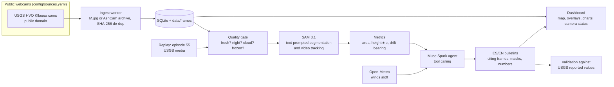

# Volcano Vigil

**An agent that watches public volcano webcams and turns every frame into measurements and plain-language bulletins.**

Volcano observatories publish webcam images every few minutes, but nobody can look at every frame all day. Volcano Vigil does: it segments plumes and lava fountains with **SAM 3.1**, measures them with camera geometry (height in meters with uncertainty, drift direction), checks the drift against forecast winds, tracks each plume over time, and lets a **Muse Spark** agent decide what to look at and write a bilingual (ES/EN) bulletin that cites its evidence: frames, masks and numbers.

**Live:** https://facurie-volcano-vigil.hf.space (the dashboard; the episode 55 replay is under "Replay").

It is built and validated on **Kīlauea** (Hawaiʻi), whose USGS webcams are public domain and whose official reports give reference values to check the agent against. Cameras, vents and their geometry live in configuration (`config/sources.yaml`, `config/calibration.yaml`), so another volcano with openly licensed webcams can be added there.

> [!IMPORTANT]
> **Volcano Vigil does not replace official volcano alerts.** It is an experimental monitoring aid. Always follow the official agency: the [USGS Hawaiian Volcano Observatory](https://www.usgs.gov/observatories/hvo) for Kīlauea. Every bulletin links to the official source.

## What makes it more than an image analyzer

1. **Physical measurement.** Plume height above the vent in meters, with uncertainty, from camera geometry (camera and vent coordinates plus a calibrated reference point). Drift direction compared with the forecast wind at plume height ([Open-Meteo](https://open-meteo.com)).
2. **Tracking over time.** Per-camera time series, and SAM 3.1 in video mode over timelapses built from the frames, so the same plume keeps a stable identity.
3. **A real agent.** Muse Spark with tool calling decides what to inspect and when to ask for more frames, detects unusable cameras (cloud, night, frozen image), cross-checks cameras against the wind, and writes the bulletin.
4. **Validation.** A replay mode runs the same pipeline over Kīlauea's episode 55 (2026-10-17) and compares its measurements with the values USGS reported.

## Architecture



Every Meta Model API call goes through a cost ledger with a configurable daily budget cap.

## Status

Work in progress during the hackathon. Implemented so far:

- [x] Camera sources config with mandatory license and opt-in `enabled` flag
- [x] Ingest worker: per-camera polling of the public image (conditional GET) or of the USGS AshCam archive (every frame, exact capture times, automatic fallback to the public image), image validation, SHA-256 de-duplication, SQLite + disk storage, camera health state
- [x] AshCam archive backfill with exact capture times (`vigil-backfill`)
- [x] SAM 3.1 phrases tuned per target on episode 55 frames ([evidence](docs/research/prompt_tuning.md))
- [x] API cost ledger with daily budget cap
- [x] Mask overlay renderer with a legend strip below the frame
- [x] Quality gate: free local checks (stale, frozen, night without incandescence, fog), Muse Spark for hazy frames, printed time and PTZ readout ([calibration](docs/research/quality_calibration.md))
- [x] SAM 3.1 video tracking over timelapses of usable frames, with per-frame masks ([episode 55 results](docs/research/tracking_ep55.md))
- [x] Camera geometry with lens distortion, calibrated from the Moon (KPcam); heights ± σ by Monte Carlo, area and drift per detection ([calibration](docs/research/calibration_ep55.md))
- [x] First validation against USGS episode 55 values ([VALIDATION.md](docs/VALIDATION.md))
- [x] Wind comparison
- [x] Muse Spark agent and bulletins
- [x] Episode 55 replay and validation
- [x] Dashboard, live and replay (`vigil-web`)
- [x] Deployment as a Hugging Face Docker Space ([DEPLOY.md](docs/DEPLOY.md)), with episode 55 mirrored on [Hugging Face](https://huggingface.co/datasets/facurie/volcano-vigil-ep55)

## Running it

Requires Python 3.11+.

```bash
python -m venv .venv
source .venv/bin/activate          # Windows: .venv\Scripts\activate
pip install -e ".[dev]"
cp .env.example .env               # then set MODEL_API_KEY

vigil-ingest --once                # poll every enabled camera once
vigil-ingest                       # keep polling on each camera's interval
vigil-backfill --camera kilauea-kp --start 2026-10-17T13:00Z --end 2026-10-17T19:30Z
                                   # download archived frames (USGS AshCam keeps ~31 days)
vigil-quality --camera kilauea-k2 --start 2026-10-17T13:00Z --end 2026-10-17T19:30Z
                                   # judge frames: local checks, Muse Spark for hazy ones
vigil-track --camera kilauea-k2 --start 2026-10-17T13:00Z --end 2026-10-17T19:30Z
                                   # SAM 3.1 video tracks over the usable frames
vigil-measure --camera kilauea-kp --start 2026-10-17T13:00Z --end 2026-10-17T19:30Z
                                   # heights ± σ, area and drift of the tracked objects
python scripts/validate_ep55.py    # compare with the official USGS values: docs/VALIDATION.md
pytest                             # run the test suite
```

Frames are stored under `data/frames/<camera>/<day>/` and indexed in `data/vigil.sqlite`. The `data/` folder is never committed.

## Built during the hackathon (Oct 26 – Nov 4, 2026)

Everything in this repository was written from scratch during the [Meta Global AI Developer Hackathon](https://dev.meta.ai), between October 26 and November 4, 2026; the commit history shows the progression. No code, data or assets predate the event.

## Data sources and credits

- Kīlauea webcam images and episode 55 media: **U.S. Geological Survey** (public domain).
- Wind forecasts: [Open-Meteo](https://open-meteo.com).

See [DATA_SOURCES.md](DATA_SOURCES.md) for every source, its license and how it is used. No images are stored in this repository.

## License

Code released under the [MIT License](LICENSE). Data belongs to its respective sources (see above).
