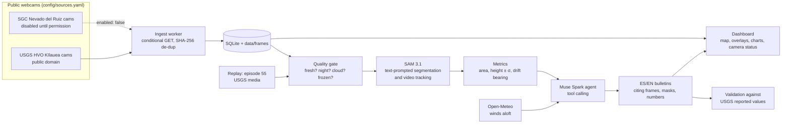

# Vigía Andino

**An agent that watches public volcano webcams and turns every frame into measurements and plain-language bulletins.**

Volcano observatories publish webcam images every few minutes, but nobody can look at every frame all day. Vigía Andino does: it segments plumes and lava fountains with **SAM 3.1**, measures them with camera geometry (height in meters with uncertainty, drift direction), checks the drift against forecast winds, tracks each plume over time, and lets a **Muse Spark** agent decide what to look at and write a bilingual (ES/EN) bulletin that cites its evidence: frames, masks and numbers.

It is built for Andean volcanoes such as **Nevado del Ruiz** (Colombia), the volcano of the 1985 Armero tragedy, and works with any camera. It is developed and validated on **Kīlauea** (Hawaiʻi), whose USGS webcams are public domain and whose official reports give reference values to check the agent against.

> [!IMPORTANT]
> **Vigía Andino does not replace official volcano alerts.** It is an experimental monitoring aid. Always follow the official agency for each volcano: [USGS Hawaiian Volcano Observatory](https://www.usgs.gov/observatories/hvo) for Kīlauea, [Servicio Geológico Colombiano](https://www2.sgc.gov.co/Noticias/Paginas/Boletines-semanales.aspx) for Nevado del Ruiz. Every bulletin links to the official source.

## What makes it more than an image analyzer

1. **Physical measurement.** Plume height above the vent in meters, with uncertainty, from camera geometry (camera and vent coordinates plus a calibrated reference point). Drift direction compared with the forecast wind at plume height ([Open-Meteo](https://open-meteo.com)).
2. **Tracking over time.** Per-camera time series, and SAM 3.1 in video mode over timelapses built from the frames, so the same plume keeps a stable identity.
3. **A real agent.** Muse Spark with tool calling decides what to inspect and when to ask for more frames, detects unusable cameras (cloud, night, frozen image), cross-checks cameras against the wind, and writes the bulletin.
4. **Validation.** A replay mode runs the same pipeline over Kīlauea's episode 55 (2026-10-17) and compares its measurements with the values USGS reported.

## Architecture



Every Meta Model API call goes through a cost ledger with a configurable daily budget cap.

## Status

Work in progress during the hackathon. Implemented so far:

- [x] Camera sources config with mandatory license and opt-in `enabled` flag
- [x] Ingest worker: per-camera polling, conditional GET, image validation, SHA-256 de-duplication, SQLite + disk storage, camera health state
- [x] API cost ledger with daily budget cap
- [x] Mask overlay renderer
- [ ] Quality gate, SAM 3.1 segmentation and tracking, metrics, wind comparison
- [ ] Muse Spark agent and bulletins
- [ ] Episode 55 replay and validation
- [ ] Dashboard and deployment

## Running it

Requires Python 3.11+.

```bash
python -m venv .venv
source .venv/bin/activate          # Windows: .venv\Scripts\activate
pip install -e ".[dev]"
cp .env.example .env               # then set MODEL_API_KEY

vigia-ingest --once                # poll every enabled camera once
vigia-ingest                       # keep polling on each camera's interval
pytest                             # run the test suite
```

Frames are stored under `data/frames/<camera>/<day>/` and indexed in `data/vigia.sqlite`. The `data/` folder is never committed.

## Built during the hackathon (Oct 26 – Nov 4, 2026)

Everything in this repository was written from scratch during the [Meta Global AI Developer Hackathon](https://dev.meta.ai), between October 26 and November 4, 2026; the commit history shows the progression. No code, data or assets predate the event.

## Data sources and credits

- Kīlauea webcam images and episode 55 media: **U.S. Geological Survey** (public domain).
- Nevado del Ruiz webcams: Servicio Geológico Colombiano. Configured but **disabled** until SGC grants permission.
- Wind forecasts: [Open-Meteo](https://open-meteo.com).

See [DATA_SOURCES.md](DATA_SOURCES.md) for every source, its license and how it is used. No images are stored in this repository.

## License

Code released under the [MIT License](LICENSE). Data belongs to its respective sources (see above).
