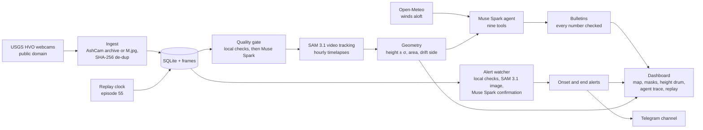

# Volcano Vigil

**An agent that watches public volcano webcams and turns their frames into measurements, alerts and plain-language bulletins.**

Volcano observatories publish webcam frames every few minutes, but nobody can look at every frame all day. Volcano Vigil does, for Kīlauea (Hawaiʻi). It segments plumes and lava fountains with **SAM 3.1**, measures them with camera geometry (heights in metres with an uncertainty, the side the plume drifts to), checks the drift against forecast winds, follows each object through time, raises an alert within minutes when lava fountaining starts or stops, and lets a **Muse Spark** agent decide what to inspect and write a bulletin in which every height and area is checked against what was measured.

- **Demo video (2:37):** https://youtu.be/XbelBKboLoo
- **Live dashboard:** https://facurie-volcano-vigil.hf.space (live mode, and the episode 55 replay under "Replay")
- **Alerts on Telegram:** [Volcano Vigil · Kīlauea](https://t.me/volcano_vigil_kilauea)
- **Episode 55 replay data:** [facurie/volcano-vigil-ep55](https://huggingface.co/datasets/facurie/volcano-vigil-ep55) on Hugging Face

> [!IMPORTANT]
> **Volcano Vigil does not replace official volcano alerts.** It is an experimental reading of public webcams. Always follow the official agency: the [USGS Hawaiian Volcano Observatory](https://www.usgs.gov/volcanoes/kilauea) for Kīlauea. Every bulletin, alert and page carries this notice and the link.

## Results on episode 55

Kīlauea's summit eruption goes in episodes. Episode 55 (2026-10-17, 03:19–09:03 HST) is replayed frame by frame through the same pipeline that runs live, and every result is compared with what HVO reported. The calibration was fixed before the comparison and never fitted to HVO's values. Full tables, methods and limitations: [docs/VALIDATION.md](docs/VALIDATION.md).

| What | Volcano Vigil | HVO | |
|---|---|---|---|
| Plume top at the peak (04:50–05:10 HST), KPcam | 6,951 ± 429 m a.s.l. | 25,000 ft (7,620 m) | −9 % |
| Plume top at 06:02 | 5,169 ± 205 m | 17,000 ft (5,182 m) | −0 % |
| Fountain at the peak, K2cam | 241 ± 14 m | 720 ft (219 m) | +10 % |
| Fountain at 06:02 | 181 ± 13 m | about 650 ft (198 m) | −9 % |
| Fountain at 07:00 | 150 ± 13 m | 500 ft (152 m) | −2 % |
| Fountain at 08:00 | 129 ± 12 m | about 300 ft (91 m); 500 ft at 07:47 in another HVO message | +41 % |
| End of fountaining (last frame with the fountain) | 09:02 K2cam, 09:01 V1cam | 09:03 | −1 and −2 min |
| Drift side | southwest in 75 of 75 KPcam frames | southwest | ✓ |
| Onset alert | fountain seen 03:07, alert 03:10 | HVO's notice 03:43 | 33 min earlier |
| End alert | last seen 09:02, alert 09:11 | HVO's notice 09:11 | same minute |
| False alarms over 29 h of overflows before the episode | 0 | | |

The replay wrote 7 bulletins, one an hour. Re-checked with the stricter rules added at the end of the hackathon, all 41 measurements they cite match the stored ones, and all 75 lengths and areas written in their text are among them. Two rows disagree, and the report says why: at 07:30 HST the plume mask's top is cloud drifting downwind, not the column; and HVO's two reports of the fountain's decline differ by 50 m.

## How it uses Meta's models

- **SAM 3.1, video mode:** each camera's usable frames of the hour become a timelapse, and SAM tracks text-prompted objects through it (`steam` for the plume, `lava fountain`, `glow`; phrases chosen on episode 55 frames, [prompt_tuning.md](docs/research/prompt_tuning.md)), so the same plume keeps one identity and every frame gets a mask.
- **SAM 3.1, image mode:** the alert watcher looks at single frames of V1cam and K2cam for a `lava fountain`, and sizes the mask against the frame.
- **Muse Spark as a quality gate:** free local checks reject fog, dark nights and frozen images; Muse Spark only judges the hazy frames they cannot decide, and reads the printed timestamp and pan-tilt-zoom values.
- **Muse Spark as the agent:** nine strict tools (camera status, frames, assess, segment, track, measure, wind, compare cameras, history), all bounded by the agent's clock so a replay never sees the future. Its final answer is a bulletin in a strict JSON format; the code adds the official source and the disclaimer, draws the evidence, checks every cited measurement against the database, and checks every length and area written in the text against those.
- **Muse Spark as a second opinion:** it confirms every fountaining onset by comparing the frame with the camera's frame 30 minutes earlier (an overflow dome can glow like a fountain), and reads the episode's timelapse to name its phases.

Every Meta Model API call goes through one client that enforces a daily budget cap and writes a cost ledger.

## Architecture



**Measuring a height.** Each camera's view (azimuth, tilt, roll, focal length, lens distortion) is solved from references whose positions are known, and a mask's highest pixel is placed on the vertical plane through the vent, with Earth curvature and refraction. A 1,000-sample Monte Carlo over the camera and vent positions, the references, the mask edge and the lean of the column gives each height its σ. KPcam, 14 km away, is calibrated from nine positions of the Moon in its frames (JPL Horizons), to 1.6 px; K2cam, 1.7 km from the vent, from its lens's datasheet field of view and a cinder cone on its skyline ([calibration_ep55.md](docs/research/calibration_ep55.md)). K2cam is a pan-tilt-zoom camera. Live, it is measured only on frames that still show the calibrated framing: each frame is compared with reference frames of that view.

**Live.** A Hugging Face Docker Space runs ingest, the pipeline (quality, hourly tracking, measuring, an hourly bulletin), the alert watcher and the dashboard as separate processes, and saves its state to a private bucket every 5 minutes ([DEPLOY.md](docs/DEPLOY.md)). Hugging Face blocks Telegram from Spaces, so alerts go out through a small Cloudflare Worker relay.

## Running it

Requires Python 3.11+ and ffmpeg (for the timelapses); node runs the dashboard's JavaScript tests if installed.

```bash
python -m venv .venv
source .venv/bin/activate          # Windows: .venv\Scripts\activate
pip install -e ".[dev]"
cp .env.example .env               # then set MODEL_API_KEY (and the Telegram values to post alerts)
pytest                             # the test suite; it never calls the network or the Meta API
```

| Command | What it does |
|---|---|
| `vigil-ingest` | Poll every enabled camera (AshCam or `M.jpg`), store new frames; `--once`, `--lookback-hours 24` |
| `vigil-backfill --camera kilauea-kp --start … --end …` | Download archived frames with exact capture times (AshCam keeps ~31 days) |
| `vigil-quality` | Judge frames: local checks, Muse Spark for hazy ones |
| `vigil-track` | SAM 3.1 video tracks over a window of usable frames |
| `vigil-measure` | Heights ± σ, area and drift side of the tracked objects |
| `vigil-wind` | Open-Meteo winds aloft over the vent |
| `vigil-agent` / `vigil-bulletin` | One agent run, or one checked bulletin, at a time (now or a past time) |
| `vigil-pipeline --volcano kilauea` | The live loop: quality, hourly tracking, measuring, hourly bulletins |
| `vigil-alerts --volcano kilauea` | The live fountaining alerts, posted to Telegram |
| `vigil-replay --episode 55` | Replay episode 55 on a simulated clock and compare with HVO |
| `vigil-web` | The dashboard at http://127.0.0.1:8000, live and replay |
| `vigil-mirror`, `vigil-persist`, `vigil-space` | Deployment: the episode mirror, the state bucket, the Space |
| `python scripts/validate_ep55.py` | Regenerate [docs/VALIDATION.md](docs/VALIDATION.md) |

To see the replay without spending anything: `vigil-mirror pull --episode 55 --repo facurie/volcano-vigil-ep55`, then `vigil-web`. Frames live under `data/` (git-ignored); no image is ever committed.

## Cost

Meta Model API spend, from the cost ledgers: **$5.09** to build and validate (prompt tuning, the quality gate, episode 55 tracking, agent probes, two full replays and the alert calibration), and **$6.22** for the live Space's first 27 hours (2026-11-01 16:08 UTC to 2026-11-02 19:00 UTC). The live Space is capped at $8 a day (`DAILY_BUDGET_USD`), of which $0.75 is kept for the alerts; it spends about $6.5. Most of the live spend is the hourly agent run.

## Built during the hackathon (Oct 26 – Nov 4, 2026)

Everything in this repository was written from scratch during the [Meta Global AI Developer Hackathon](https://dev.meta.ai), between October 26 and November 4, 2026; the commit history shows the progression, and [docs/PLAN.md](docs/PLAN.md) with [docs/superpowers/plans/](docs/superpowers/plans/) records each phase's plan and what happened. No code, data or assets predate the event.

## Data sources and credits

- Webcam frames, eruption reports and the vent positions: **U.S. Geological Survey**, Hawaiian Volcano Observatory (public domain).
- Winds aloft: [Open-Meteo](https://open-meteo.com) (CC BY 4.0).
- Calibration references: USGS GNIS and 3DEP elevations (public domain), NASA/JPL Horizons for the Moon's positions, and Axis Communications' published field of view for the AXIS Q6318-LE.
- Map tiles: USGS The National Map imagery; map library [Leaflet](https://leafletjs.com) (BSD-2-Clause); type [IBM Plex](https://github.com/IBM/plex) (SIL OFL).

See [DATA_SOURCES.md](DATA_SOURCES.md) for every source, its license and how it is used.

## License

Code released under the [MIT License](LICENSE). Data belongs to its respective sources (see above).
